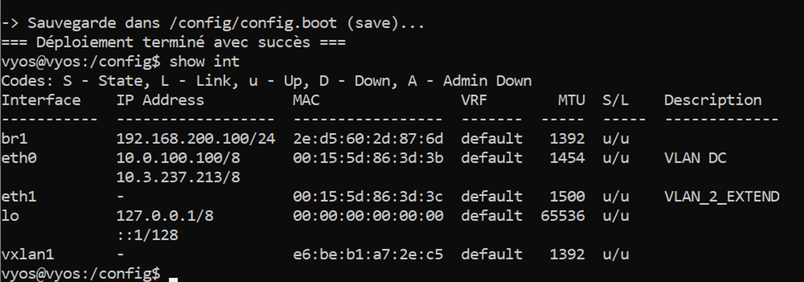
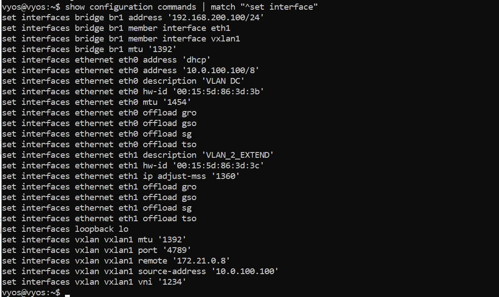

# Script de configuration de VyOS pour une utilisation en tant que passerelle VTEP

L'objectif de ce repo est de fournir des scripts permettant la configuration facile d'une passerelle VTEP sur une appliance VyOS.

Un cas d'usage typique est l'utilisation de VyOS comme passerelle VTEP pour faire l'interconnexion et l'extension d'un sous-réseau niveau 2 avec un subnet Flow dans un cluster Nutanix qui lui-même dispose de sa [passerelle VTEP Nutanix](https://portal.nutanix.com/page/documents/details?targetId=Nutanix-Flow-Virtual-Networking-Guide:ear-virtual-subnet-extend-vtep-c.html).

Un exemple simplifié d'architecture avec une extension du niveau 2 entre un sous-réseau à demeure et un flow subnet hébergé dans Nutanix Cloud Cluster (NC2) chez un hyperscaler.

 


## VyOS Installation

Télécharger l'image ISO VyOS sur [https://vyos.net/get/](https://vyos.net/get/) 

Prérequis et installation de VyOS : https://docs.vyos.io/en/1.5/installation/index.html 


## Structure de ce repo

Placez toujours vos scripts dans /config/scripts/, car le répertoire /config est le seul à être automatiquement conservé lors des mises à jour d'image système (add system image).

```text
/config/scripts/provisioning/
├── deploy.sh                  # Orchestrateur principal (exécutable)
└── modules/
    ├── 01-system.cfg          # Hostname, DNS, NTP, SSH, utilisateurs
    ├── 02-interfaces.cfg      # Interfaces physiques, VLANs, adresses IP
    ├── 03-nat.cfg             # Règles SNAT / DNAT
    ├── 04-firewall.cfg        # Groupes et règles de filtrage (nftables)
    └── 05-services.cfg        # Serveur DHCP, relais DNS, routage
```

## Connexion initiale

Ouvrir une session sur la console et configurer à minima une interface réseau avec une IP, une route par défaut et un résolution de nom. Cloner également le contenu de ce repo.

```bash
conf
set interfaces ethernet eth0 address "dhcp"
# Route par défaut
set protocols static route 0.0.0.0/0 next-hop 10.0.0.1
# Serveur DNS (exemple avec celui de Google)
set system name-server '8.8.8.8'
commit
save
exit
cd /config/scripts
git clone https://github.com/squasta/VyOS-config-script-L2-Extension
```

 


## Script orchestrateur (deploy.sh)

Ce script ouvre une session CLI VyOS unique, charge chaque fichier .cfg par ordre alphabétique, valide l'ensemble des dépendances en une passe (commit), puis sauvegarde dans /config/config.boot (save).

Rendez le script exécutable :

```bash
chmod +x /config/scripts/VyOS-config-script-L2-Extension/deploy.sh
```

 


## Modules de commandes set

Les fichiers .cfg contiennent uniquement des commandes set (et éventuellement delete pour l'idempotence) ainsi que des commentaires.

MODIFIER ces fichiers avec les bonnes adresses IP à utiliser et les paramètres souhaités.


## Exécution du script

```bash
cd 
/config/scripts/VyOS-config-script-L2-Extension/deploy.sh
```

 

 


## Points clés pour l'automatisation en production

### Idempotence lors des ré-exécutions : 
Dans VyOS, relancer une commande set déjà présente est sans effet (pas d'erreur).

En revanche, si vous supprimez une entrée de votre fichier (par exemple un serveur DNS ou une règle de pare-feu), elle restera active sur le routeur tant que vous n'aurez pas exécuté un delete ciblé (comme delete system name-server avant de redéfinir la liste).
 
### Intégration Zero-Touch (Cloud-init / Ansible) :Cloud-init :
  - Vous pouvez cloner votre dépôt Git dans /config/scripts/provisioning/ via runcmd au premier démarrage et appeler ./deploy.sh (le script basculera automatiquement sur vyattacfg grâce à l'en-tête). 
  -  Ansible : La collection officielle [vyos.vyos](https://docs.ansible.com/projects/ansible/latest/collections/vyos/vyos/index.html) (vyos.vyos.vyos_config) permet également d'envoyer directement ces fichiers .cfg via le paramètre src: en gérant nativement les diffs et les sauvegardes.

### Extraction de l'existant :
Pour extraire un élément de configuration déjà en place sur un VyOS de test en fichiers modulaires, exécutez la commande suivante (avec interface, nat, service...) en mode opérationnel.   
```bash
   show configuration commands | match "^set interface"
```

   
   
