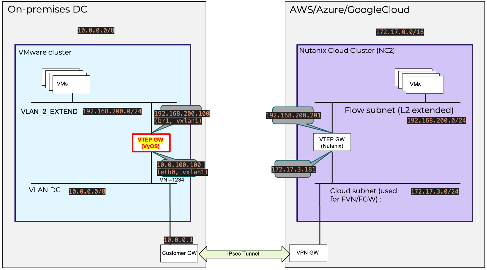
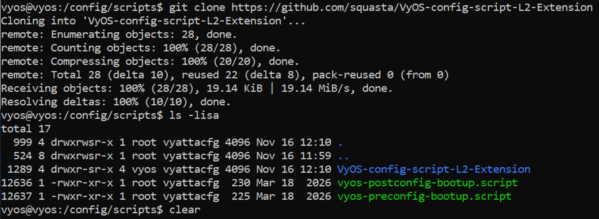
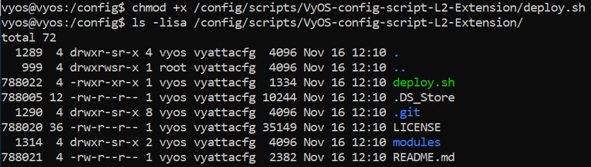
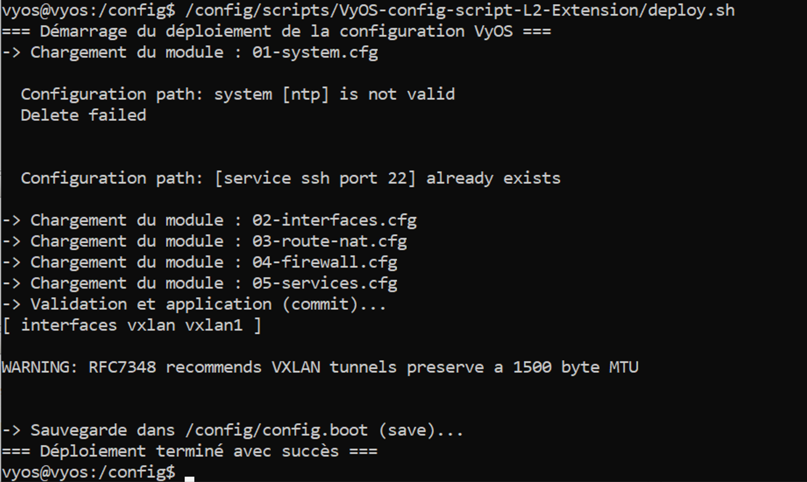

# VyOS Configuration Script for VTEP Gateway Deployment

Version française ici --> [README-FR.md](README-FR.md) 

The goal of this repository is to provide scripts that streamline the configuration of a VTEP (VXLAN Tunnel Endpoint) gateway on a VyOS appliance.

A typical use case is deploying VyOS as a VTEP gateway to interconnect and extend an on-premises Layer 2 subnet with a Flow subnet in a Nutanix cluster, which utilizes its own [Nutanix VTEP gateway](https://portal.nutanix.com/page/documents/details?targetId=Nutanix-Flow-Virtual-Networking-Guide:ear-virtual-subnet-extend-vtep-c.html).

Below is a simplified architecture example illustrating a Layer 2 extension between an on-premises subnet and a Flow subnet hosted in a Nutanix Cloud Cluster (NC2) on a hyperscaler.

 


## VyOS Installation

Download the VyOS ISO image from [https://vyos.net/get/](https://vyos.net/get/) 

VyOS prerequisites and installation guide: https://docs.vyos.io/en/1.5/installation/index.html 


## Repository Structure

Always store your scripts in `/config/scripts/`, as the `/config` directory is the only path automatically preserved during system image upgrades (`add system image`).

```text
/config/scripts/provisioning/
├── deploy.sh                  # Main orchestrator script (executable)
└── modules/
    ├── 01-system.cfg          # Hostname, DNS, NTP, SSH, users
    ├── 02-interfaces.cfg      # Physical interfaces, VLANs, IP addresses
    ├── 03-nat.cfg             # SNAT / DNAT rules
    ├── 04-firewall.cfg        # Firewall groups and filtering rules (nftables)
    └── 05-services.cfg        # DHCP server, DNS forwarding, routing
```

## Initial Connection

Open a console session and configure at least one network interface with an IP address, a default route, and DNS name resolution. Then, clone the contents of this repository.

```bash
conf
set interfaces ethernet eth0 address "dhcp"
# Default route
set protocols static route 0.0.0.0/0 next-hop 10.0.0.1
# DNS server (Google DNS example)
set system name-server '8.8.8.8'
commit
save
exit
cd /config/scripts
git clone https://github.com/squasta/VyOS-config-script-L2-Extension
```

 


## Orchestrator Script (deploy.sh)

This script initiates a single VyOS CLI session, loads each `.cfg` file in alphabetical order, validates all dependencies in a single pass (`commit`), and saves the configuration to `/config/config.boot` (`save`).

Make the script executable:

```bash
chmod +x /config/scripts/VyOS-config-script-L2-Extension/deploy.sh
```

 


## Configuration Modules (`set` Commands)

The `.cfg` files contain strictly `set` commands (and optionally `delete` commands to ensure idempotency) along with comments.

**UPDATE** these files with the appropriate IP addresses and your desired network parameters before execution.


## Script Execution

```bash
cd 
/config/scripts/VyOS-config-script-L2-Extension/deploy.sh
```

 

 


## Key Considerations for Production Automation

### Idempotency on Re-runs
In VyOS, re-running a `set` command that already exists in the active configuration has no effect and will not throw an error.

However, if you remove an entry from your configuration file (such as a DNS server or a firewall rule), it will remain active on the router until you explicitly execute a targeted `delete` command (for example, `delete system name-server` before redefining the list).
 
### Zero-Touch Integration (Cloud-init / Ansible)
* **Cloud-init:** You can clone your Git repository into `/config/scripts/provisioning/` via `runcmd` on first boot and execute `./deploy.sh` (the script will automatically switch to the `vyattacfg` group using its header). 
* **Ansible:** The official [vyos.vyos](https://docs.ansible.com/projects/ansible/latest/collections/vyos/vyos/index.html) collection (`vyos.vyos.vyos_config`) also allows you to push these `.cfg` files directly using the `src:` parameter, natively handling configuration diffs and saves.

### Extracting Existing Configurations
To extract an existing configuration section from a test VyOS instance into modular files, run the following command (replacing `interface` with `nat`, `service`, etc.) in [operationnal](https://docs.vyos.io/en/1.5/cli.html):

```bash
show configuration commands | match "^set interface"
```

